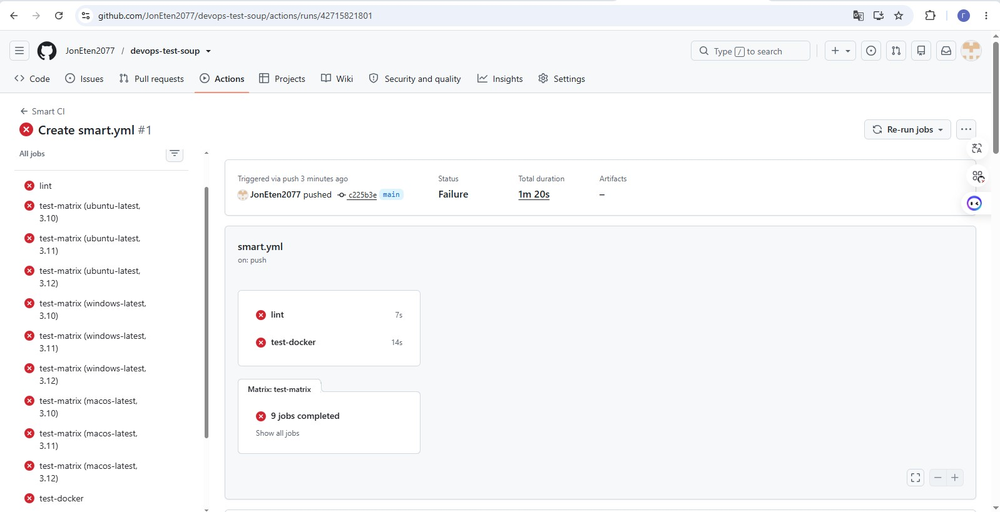
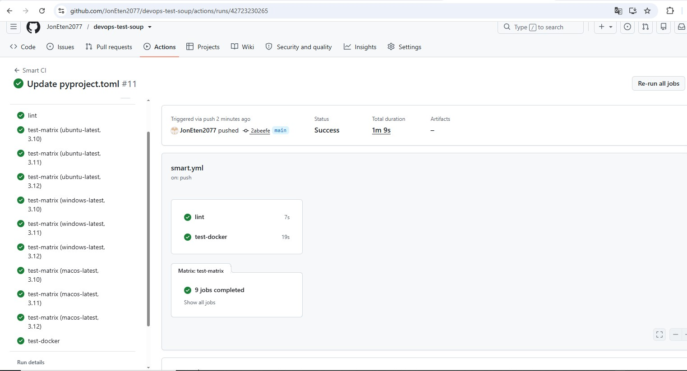
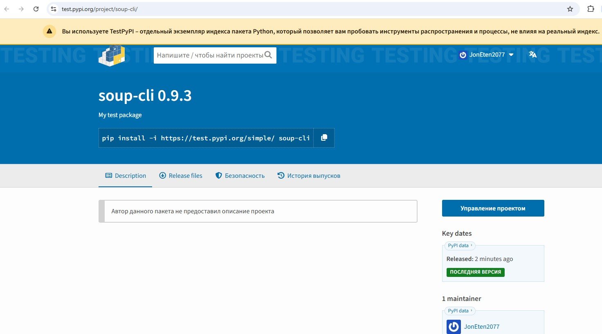

# Отчет по заданию DevOps Engineer

## 1. Воспроизведение инцидента (Naive Pipeline)
Я создал минимальный CLI-пакет `soup-cli`, в который намеренно внедрил 4 бага, ломающих пакет для пользователей:
1. `ImportError` на Python 3.10 (использование `tomllib`).
2. Падение на Windows (хардкод пути `/tmp`).
3. Отсутствие зависимости `requests` в `pyproject.toml`.
4. Отсутствие `data.json` в собранном Wheel.

**Доказательство:** Наивный пайплайн (`.github/workflows/naive.yml`), который запускает скрипт только на Ubuntu + Python 3.11, показывает **зеленый статус**, хотя пакет сломан.

## 2. Умный пайплайн (Smart CI)
Для поимки этих багов я построил пайплайн (`.github/workflows/smart.yml`), включающий:
*   Lint (ruff).
*   Матрицу ОС (Ubuntu, Windows, macOS) и версий Python (3.10, 3.11, 3.12).
*   Сборку Wheel и установку в чистом окружении.
*   Тестирование в Docker.

**Доказательство (Green Run):** После исправления кода (переход на `tempfile`, `importlib.resources`, добавление зависимостей) все 11 задач стали зелеными. (Красный запуск с ошибками также прилагается в истории Actions).

**Чего пайплайн НЕ ловит:** Бизнес-логику (если CLI выводит неверные данные, но не падает) и проблемы с производительностью.

## 3. Silent Supply-Chain Failures (Закрыто 3 кейса)
1. **Version Mismatch:** Настроен шаг в `publish.yml`, который сверяет Git-тег (`v0.9.3`) с версией в `pyproject.toml` (`0.9.3`). Если они разойдутся — пайплайн упадет.
2. **OIDC вместо токенов:** Публикация на TestPyPI настроена через Trusted Publisher (OpenID Connect). Никаких секретов (токенов) в GitHub не хранится. 
3. **Unpinned Dependencies:** Зависимость `requests` зафиксирована до точной версии (`requests==2.32.3`).

**Доказательство успешной публикации:** Пакет успешно опубликован на TestPyPI.

## 4. GPU CI (Теория)
Для тестирования GPU-зависимостей я бы использовал **AWS EC2 Spot Instances** (инстансы `g4dn.xlarge`).
*   **Стоимость:** Около $0.15 - $0.20 в час. Nightly-тесты на 30 минут = **$3–$5 в месяц**.
*   **Как не сжигать деньги:** Запускать GPU-тесты только ПОСЛЕ базовых CPU-тестов, использовать Spot-инстансы и внедрить шаг авто-остановки (Terminate instance) в блоке `always()`.

## 5. Вердикт: Можно ли доверять публикацию без человека?
**Нет, полностью автономная публикация на реальный PyPI опасна.** Пайплайн гарантирует, что пакет не падает, но не может проверить бизнес-ценность или логические ошибки. Рекомендую использовать **Human-in-the-loop**: пайплайн делает всю работу и останавливается перед публикацией, ожидая ручного аппрува через GitHub Environments.

---
## Что удивило и что беспокоит
**Удивило:** То, как легко пропустить критический баг, если тестировать только в одном окружении. Мой «идеальный» локальный код падал на Windows из-за кодировки, а на чистой установке — из-за отсутствия `__init__.py`.
**Беспокоит:** Безопасность сторонних GitHub Actions. Если аккаунт мейнтейнера взломают и подменят код экшена, злоумышленники получат доступ к нашему пайплайну. Решение — фиксировать экшены по SHA-хэшу.

---
**Использование ИИ:** 
Я использовал ИИ для генерации базового шаблона YAML. ИИ предложил использовать секреты (`secrets.PYPI_TOKEN`), но я переделал это на OIDC. Также ИИ не учел проблему с PowerShell на Windows (добавил `shell: bash`) и строгость линтера `ruff` (исправил вручную).
