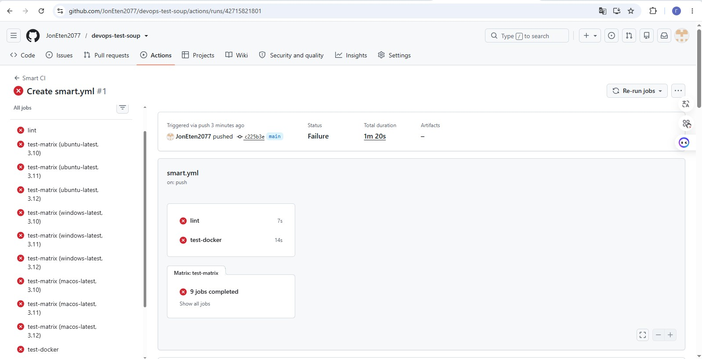
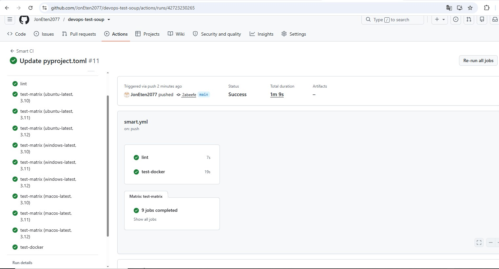
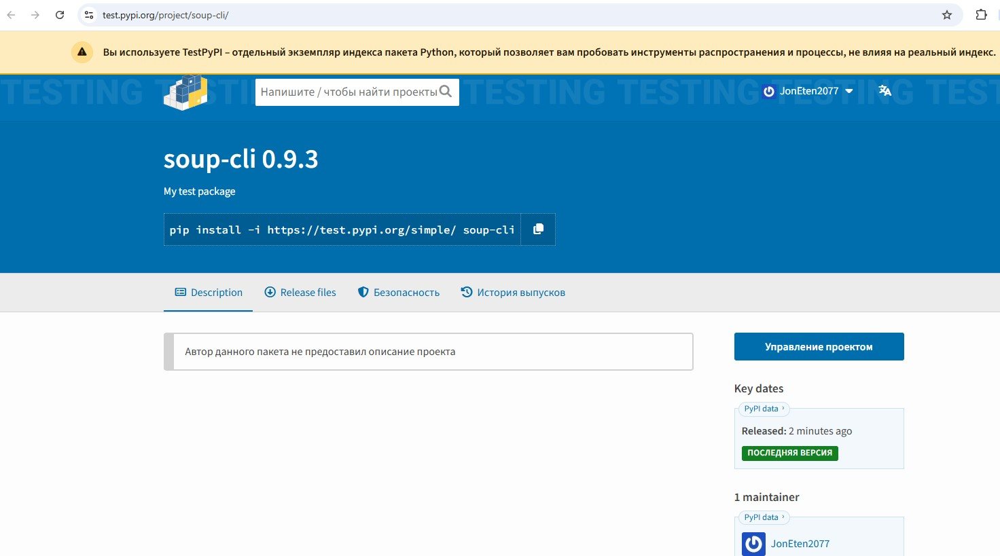

# DevOps Engineer Assignment Report

## 1. Reproducing the Incident (Naive Pipeline)
I created a minimal CLI package `soup-cli` with 4 deliberately injected bugs that break the package for users:
1. `ImportError` on Python 3.10 (using `tomllib`, available only from 3.11+).
2. Crash on Windows (hardcoded `/tmp` path).
3. Missing `requests` dependency in `pyproject.toml`.
4. Missing `data.json` in the built Wheel (not included in `package-data`).

**Evidence:** The Naive pipeline (`.github/workflows/naive.yml`), which only runs on Ubuntu + Python 3.11, shows a **green status**, even though the package is broken.

## 2. Smart Pipeline (Smart CI)
To catch these bugs, I built a pipeline (`.github/workflows/smart.yml`) that includes:
*   Lint (ruff).
*   OS matrix (Ubuntu, Windows, macOS) and Python versions (3.10, 3.11, 3.12).
*   Building the Wheel and installing it in a clean environment.
*   Testing inside Docker.

**Evidence (Red Run):** The pipeline failed on Windows (PowerShell paths), Python 3.10, and clean install (missing dependencies). *[See Actions history for the red run].*

**Evidence (Green Run):** After fixing the code (switching to `tempfile`, `importlib.resources`, adding dependencies), all 11 jobs turned green.

**What the pipeline does NOT catch:** Business logic (e.g., CLI outputs incorrect data but doesn't crash) and performance issues (memory leaks, slow startup).

## 3. Silent Supply-Chain Failures (3 cases closed)
1. **Version Mismatch:** A step in `publish.yml` compares the Git tag (`v0.9.3`) with the version in `pyproject.toml` (`0.9.3`). If they diverge, the pipeline fails.
2. **OIDC instead of tokens:** Publishing to TestPyPI is configured via Trusted Publisher (OpenID Connect). No secrets (tokens) are stored in GitHub.
3. **Unpinned Dependencies:** The `requests` dependency is pinned to an exact version (`requests==2.32.3`) to prevent unexpected updates from breaking the package.

**Evidence of successful publishing:** The package is successfully published on TestPyPI.

## 4. GPU CI (Theory)
To test GPU dependencies, I would use **AWS EC2 Spot Instances** (`g4dn.xlarge`).
*   **Cost:** ~$0.15 - $0.20 per hour. Nightly 30-minute tests = **$3–$5 per month**.
*   **Cost optimization:** Run GPU tests only AFTER basic CPU tests pass, use Spot instances, and implement an auto-termination step (Terminate instance) in the `always()` block.

## 5. Verdict: Can it publish without a human?
**No, fully autonomous publishing to real PyPI is dangerous.** The pipeline guarantees the package won't crash but cannot verify business value or logical errors. I recommend using a **Human-in-the-loop** approach: the pipeline does all the work and stops before publishing, waiting for manual approval via GitHub Environments.

---
## What surprised me and what still concerns me
**Surprise:** How easy it is to miss a critical bug if you only test in one environment. My "perfect" local code crashed on Windows due to encoding, and on clean install due to a missing `__init__.py`.
**Concern:** The security of third-party GitHub Actions. If a maintainer's account is compromised and the Action's code is swapped, attackers gain access to our pipeline. The solution is to pin Actions by SHA hash.

---
**AI Usage:** 
I used AI to generate the boilerplate YAML. The AI suggested using secrets (`secrets.PYPI_TOKEN`), but I refactored it to use OIDC instead. The AI also missed the PowerShell issue on Windows (I added `shell: bash`) and the strictness of the `ruff` linter (I fixed it manually).
